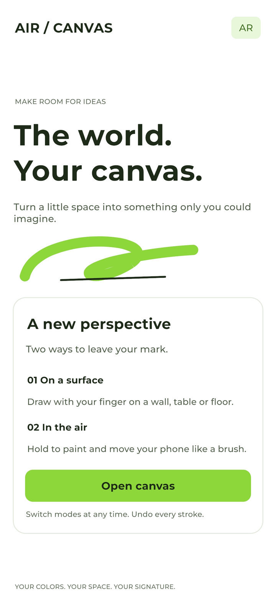
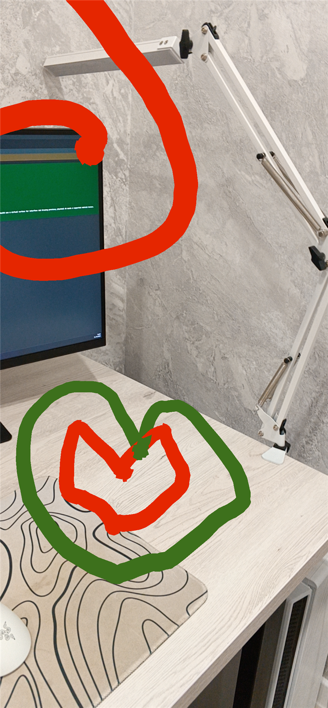

# AirCanvasAR

Turn the world into your canvas. An AR drawing app built with Unity: sketch on real surfaces with your finger or paint in the air by moving your phone.

## Features

- **Two drawing modes:** draw on walls, tables and floors, or use your phone as a brush in the air.
- **Switch modes while drawing** without leaving the canvas.
- **Full color palette** with hue, saturation, brightness and HEX input.
- **Adjustable brush width and air-brush distance.**
- **Undo and redo** individual strokes, including clearing the canvas, within the current session.
- **Save to your gallery:** export a PNG of your artwork and camera view without the interface.
- **Light portrait interface** with green accents, safe-area spacing and Montserrat 500/700 typography.
- **Adaptive and themed Android icons.**
- **Android 10 and later** on ARCore-supported devices.

## Screenshots

<table>
  <tr>
    <td align="center" width="50%"></td>
    <td align="center" width="50%"></td>
  </tr>
  <tr>
    <td align="center"><strong>Your canvas starts here</strong> Main menu</td>
    <td align="center"><strong>Leave your mark in AR</strong> Artwork saved to the gallery</td>
  </tr>
</table>
